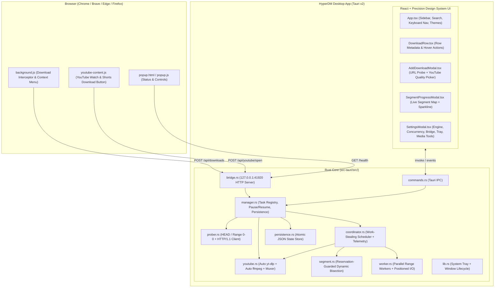

# HyperDM — Complete Developer & Architecture Guide

Everything you need to know about how **HyperDM** works under the hood, why each technical decision was made, how all the pieces fit together, and how to run, debug, extend, and release it.

---

## 1. High-Level Overview

**HyperDM** is a cross-platform (Linux & Windows) desktop download manager inspired by **Internet Download Manager (IDM)**. It is built with:

| Layer | Technology | Why It Was Chosen |
|---|---|---|
| **Core Download Engine** | **Rust** (`tokio`, `reqwest`, `serde`) | Native speed, low memory, rock-solid concurrency, zero GC pauses during high-speed disk/network I/O. |
| **Desktop Shell** | **Tauri v2** (`tray-icon`, `dialog`) | Tiny binary (~5–10 MB vs ~150 MB Electron), native OS webview, direct Rust IPC, native system tray. |
| **Frontend UI** | **React 19 + TypeScript + Tailwind CSS v4** | Fast component UI styled with a **Linear/Raycast-inspired precision design system** (Dark & Light CSS token themes). |
| **Browser Integration** | **Manifest V3 Extension** + Loopback HTTP Bridge | Works on Chrome, Brave, Edge, Vivaldi, Opera, and Firefox; passes cookies/referer/UA + injects an auto-hiding YouTube download button. |
| **YouTube Support** | **Hybrid (`yt-dlp` + HyperDM Engine + `ffmpeg`)** | Reliable extraction via auto-downloaded `yt-dlp`, full multi-segment speed via HyperDM, lossless remuxing via auto-downloaded `ffmpeg`. |

---

## 2. System Architecture



---

## 3. Repository File Map

```text
HyperDm/
├── .github/workflows/
│   └── release.yml                  # Automated Windows (.exe/.msi) + Linux (.AppImage/.deb/.rpm) + Extension ZIP releases
├── browser-extension/
│   ├── manifest.json                # Manifest V3 (Chrome/Brave/Edge/Firefox compatible)
│   ├── background.js                # Intercepts downloads, fetches cookies, right-click menu, talks to 127.0.0.1:41920
│   ├── youtube-content.js           # Injects auto-hiding download button on YouTube Watch & Shorts players
│   ├── popup.html / popup.js        # Extension popup (Connected/Offline status, toggle, port, quick send)
│   └── icons/icon128.png
├── src/                             # React + TypeScript Frontend
│   ├── index.css                    # Precision Design System CSS custom properties (Dark + Light themes, switches, sliders)
│   ├── main.tsx                     # React entrypoint
│   ├── App.tsx                      # Slim Sidebar, Search Bar, Keyboard Navigation, Download List, Event Listeners
│   ├── api/tauri.ts                 # Typed wrappers for Tauri invoke() and listen()
│   ├── types/download.ts            # TypeScript interfaces mirroring Rust models
│   ├── utils/format.ts              # formatBytes, formatSpeed, formatEta, progressPercent
│   └── components/
│       ├── DownloadRow.tsx          # Download list row with file-type/thumbnail visual, metadata, hover action pill
│       ├── AddDownloadModal.tsx     # Direct URL probe + YouTube thumbnail/title/quality picker
│       ├── SegmentProgressModal.tsx # Live multi-segment visualizer bar, speed sparkline, per-connection table
│       └── SettingsModal.tsx        # Default folder, connections, split size, concurrency, bridge, tray, yt-dlp/ffmpeg installers
└── src-tauri/                       # Rust Backend & Tauri Shell
    ├── Cargo.toml                   # Rust dependencies (tauri + tray-icon, single-instance, tokio, reqwest, serde, uuid, etc.)
    ├── tauri.conf.json              # Window config, bundle targets, cross-platform icons
    ├── capabilities/default.json    # Tauri v2 window permissions (dialog:allow-open, core:default)
    ├── icons/                       # Full icon set (.ico, .icns, PNGs, Store logos)
    └── src/
        ├── main.rs                  # Binary entrypoint
        ├── lib.rs                   # Tauri setup: DownloadManager, HTTP bridge, System Tray, single-instance, close-to-tray
        ├── commands.rs              # All #[tauri::command] IPC endpoints
        └── engine/
            ├── mod.rs               # Module declarations
            ├── models.rs            # Shared structs & enums (DownloadTaskInfo, SegmentSnapshot, AppSettings, etc.)
            ├── prober.rs            # HTTP/1.1 client builder, HEAD + Range 0-0 probing, filename extraction
            ├── segment.rs           # LiveSegment & race-free dynamic work-stealing bisection
            ├── worker.rs            # Parallel range workers, 8 MiB googlevideo sub-ranging, cross-platform positioned I/O
            ├── coordinator.rs       # Orchestrates workers, telemetry ticks, parallel companion audio download & ffmpeg muxing
            ├── manager.rs           # Global registry, queue enforcement, ActiveRun pause/resume sync, URL refresh, persistence
            ├── persistence.rs       # Atomic JSON read/write for downloads.json & settings.json
            ├── bridge.rs            # Loopback HTTP server (127.0.0.1:41920) with strict Origin validation
            ├── youtube.rs           # YouTube URL detection, auto-managed yt-dlp & ffmpeg, language-aware format pairing, ffmpeg remux
            └── tests.rs             # 10 automated unit & integration tests (with in-process HTTP test server + ffprobe)
```

---

## 4. How the Core Features Work (Deep Dive)

### A. IDM-Style Dynamic File Segmentation (Work-Stealing)
Naive downloaders split a file into $N$ static chunks; if 1 connection is slow, the other $N-1$ connections finish and sit idle waiting for the slow tail.

**How HyperDM solves this (`segment.rs` + `coordinator.rs`):**
1. When a download starts, the file is split into up to `max_connections` (default `8`, max `16`) initial byte ranges.
2. Whenever **any worker finishes its segment**, the coordinator calls `try_split_largest_segment()`:
   - It finds the active segment with the **largest remaining unreserved tail**.
   - If that tail is $\ge$ `min_split_size_bytes` (default `512 KiB`), it atomically bisects it in half:
     - The slow worker's upper bound `end` shrinks to `mid` (without dropping its TCP connection!).
     - The idle worker immediately starts a new range `[mid + 1, old_end]`.
3. **Race-Free Disk Reservation (`reserve_write` / `commit_write`)**:
   - Before writing a 512 KiB buffer to disk, a worker reserves those exact bytes under a tiny lock (`bounds.reserved += to_write`), then releases the lock during disk I/O.
   - `try_split` only splits bytes *after* `start + bounds.reserved`. This mathematically guarantees **zero overlapping writes and zero missing bytes**.

### B. Zero-Copy Assembly (Direct Positioned Disk I/O)
Instead of writing 8 separate `.part1`, `.part2`, ... files and wasting time + 2x disk space concatenating them at the end:
- HyperDM pre-allocates a single `<filename>.hyperdm.part` file (`file.set_len(total_size)`).
- Every worker writes directly to its exact byte offset:
  - **Linux / macOS**: `std::os::unix::fs::FileExt::write_all_at` (`pwrite` syscall).
  - **Windows**: loop over `std::os::windows::fs::FileExt::seek_write`.
- When all segments complete, `.hyperdm.part` is atomically renamed to the final filename.

### C. Why Downloads Are Fast (Key Network Optimizations)
During development we fixed three real-world speed bottlenecks worth remembering:
1. **HTTP/1.1 Multi-TCP (`.http1_only()` in `prober.rs`)**:
   By default, `reqwest` uses HTTP/2 over HTTPS, which multiplexes all 8–16 workers over **one single TCP connection** (defeating multi-connection acceleration). Forcing HTTP/1.1 opens a **dedicated TCP socket per worker**, just like IDM.
2. **YouTube `googlevideo.com` 8 MiB Sub-Ranging (`worker.rs`)**:
   YouTube's CDN throttles any single `Range` request larger than ~10 MiB. Whenever a URL contains `googlevideo.com`, workers automatically cap each HTTP `Range` request to **8 MiB** and seamlessly chain the next 8 MiB over the same warm HTTP/1.1 Keep-Alive connection.
3. **Fresh Socket on Retry + 512 KiB Zero-Copy Flushes (`worker.rs`, `coordinator.rs`)**:
   If a CDN closes an idle pooled socket (`error sending request for url`), retries automatically send `Connection: close` to force a fresh TCP/TLS handshake, and write buffers are swapped via `std::mem::replace` every 512 KiB.

### D. Pause, Resume & Persistence
- State is saved atomically (`write temp → rename`) to `<app_data_dir>/downloads.json` every 2 seconds during active downloads and immediately on Pause/Complete/Error.
- **Important Tauri Lesson Learned**: Any Tauri command that calls `tokio::spawn` (like `resume_download`) **must be `async fn`**, because synchronous `#[tauri::command]` handlers run outside Tauri's Tokio runtime and would panic.
- **Rapid Pause → Resume Safety (`ActiveRun` in `manager.rs`)**: Each download run has a unique `run_id` and a `tokio::sync::watch::Receiver<bool>`. If you hit Resume milliseconds after Pause, HyperDM awaits the paused coordinator's buffer flush before spawning the resumed run.

### E. YouTube Video Downloading (Zero-Setup Hybrid Pipeline)
1. **Detection & Extraction (`youtube.rs`)**:
   - Detects `youtube.com/watch`, `youtu.be/`, `youtube.com/shorts/`, `music.youtube.com/watch`, and `/live/`.
   - Checks `PATH` for `yt-dlp`; if missing, automatically downloads the official standalone `yt-dlp` binary (`yt-dlp_linux` / `yt-dlp.exe`) into `<app_data_dir>/bin/`.
   - Runs `yt-dlp --dump-single-json --no-playlist --skip-download <url>` and curates a clean list of qualities (`2160p 4K`, `1440p`, `1080p`, `720p`, `360p Direct`, `Audio Only`).
2. **Adaptive HD/4K Download + Auto-Managed `ffmpeg` Muxing**:
   - Downloads the video track using HyperDM's full **Dynamic Segmentation Engine** (so you see the live segment map & full multi-TCP speed).
   - Downloads the companion M4A/Opus audio track in 4 MiB ranged chunks with retries & stall timeouts.
   - Checks `PATH` and `<app_data_dir>/bin/` for `ffmpeg`; if missing, automatically streams a standalone static `ffmpeg` binary from `eugeneware/ffmpeg-static`.
   - Runs `ffmpeg -nostdin -y -i <video.part> -i <audio.part> -map 0:v:0 -map 1:a:0 -c copy -movflags +faststart <final.mp4>` (instant lossless remux, with automatic AAC audio fallback if needed), then deletes both `.part` files.

### F. Browser Extension & Local HTTP Bridge
- HyperDM runs a loopback-only HTTP server on `127.0.0.1:41920` (`bridge.rs`) with three endpoints:
  - `GET /health` → lets the extension check if HyperDM is running.
  - `POST /api/downloads` → receives `{ url, fileName, referer, userAgent, cookies }` from intercepted browser downloads and forwards those headers to every worker.
  - `POST /api/youtube/open` → receives a YouTube page URL from the floating **`⚡ Download with HyperDM`** pill, brings HyperDM to the front, and opens the Material 3 quality picker pre-probed.
- If HyperDM is closed, the extension's `/health` check fails within 500ms and lets the browser download normally.

### G. System Tray & Close-to-Tray
- Enabled via Tauri v2's `tray-icon` feature (`lib.rs`).
- Tray menu includes **Show HyperDM**, **Pause All Downloads**, **Resume All Downloads**, and **Quit HyperDM**.
- Closing the main window hides HyperDM to the tray by default (configurable in Settings) so active downloads and the browser extension bridge stay alive.
- *(Note on Arch Linux)*: You may see a harmless GLib stderr notice `libayatana-appindicator is deprecated`—that comes from Tauri v2's upstream `tray-icon` crate and does not affect functionality.

### H. Precision Desktop UI (Linear / Raycast Inspired)
- Defined in `src/index.css` using semantic CSS custom properties (`--bg-app`, `--bg-sidebar`, `--bg-elevated`, `--bg-subtle`, `--accent`, `--border-subtle`, etc.).
- Supports both **Dark** (default) and **Light** (`[data-theme="light"]`) themes toggled from the top toolbar and persisted in `localStorage`.
- Includes full keyboard navigation (`Ctrl+N` new download, `Ctrl+K` search, `↑`/`↓` row selection, `Space` pause/resume, `Enter` open/inspect, `Escape` close).

---

## 5. Essential Commands

### Local Development
```bash
# Install frontend packages
npm install

# Run HyperDM desktop app (hot-reloads React UI + rebuilds Rust on change)
npm run tauri dev
```

### Testing & Building
```bash
# Run all 10 Rust unit & integration tests (work-stealing, pause/resume, retry, bridge, queue, YouTube, ffmpeg mux)
cd src-tauri && cargo test -- --nocapture

# Typecheck and build React frontend
npm run build

# Build native Linux installer locally (.AppImage / .deb / .rpm)
npm run tauri build
```

### Loading the Browser Extension
- **Chrome / Brave / Edge / Vivaldi**: `chrome://extensions` → enable **Developer mode** → **Load unpacked** → select `browser-extension/`.
- **Firefox**: `about:debugging#/runtime/this-firefox` → **Load Temporary Add-on...** → select `browser-extension/manifest.json`.

---

## 6. Automated Releases

Pushing any `v*` tag on `main` (e.g. `v1.0.0`) automatically triggers `.github/workflows/release.yml` on GitHub Actions, which:
1. Runs `cargo test` on both `windows-latest` and `ubuntu-22.04`.
2. Builds Windows (`.exe` NSIS + `.msi`) and Linux (`.AppImage` + `.deb` + `.rpm`) installers via `tauri-apps/tauri-action`.
3. Zips `browser-extension/` into `hyperdm-browser-extension.zip`.
4. Publishes all assets to a GitHub Release on `https://github.com/suraj1803/HyperDm/releases`.

```bash
git tag v1.0.1
git push origin v1.0.1
```

---

## 7. Where Runtime Data Lives

- **Linux**: `~/.local/share/com.hyperdm.app/`
- **Windows**: `%APPDATA%\com.hyperdm.app\`

Inside that folder:
- `downloads.json` — persisted download list & per-segment resume progress
- `settings.json` — user preferences
- `bin/yt-dlp` (or `yt-dlp.exe`) — auto-managed `yt-dlp` binary
- `bin/ffmpeg` (or `ffmpeg.exe`) — auto-managed `ffmpeg` binary

---

## 8. Ideas for Future Enhancements

If you want to keep building on HyperDM later, the architecture is already structured to add these cleanly:
1. **Global & Per-Download Speed Limiter**: Add a shared `tokio` token-bucket rate limiter inside `worker.rs` before `stream.next()`.
2. **Scheduled Downloads**: Add start/stop time windows on queued tasks in `manager.rs`.
3. **YouTube Playlists & Subtitles**: Extend `youtube.rs` with `--flat-playlist` JSON parsing and batch `add_download` calls.
4. **File Categories & Auto-Sorting**: Route `.mp4` → `Downloads/Videos`, `.zip` → `Downloads/Archives`, `.pdf` → `Downloads/Documents`, etc.
5. **Checksum Verification**: Compute SHA-256 / MD5 of completed files in the Segment Progress Modal.
